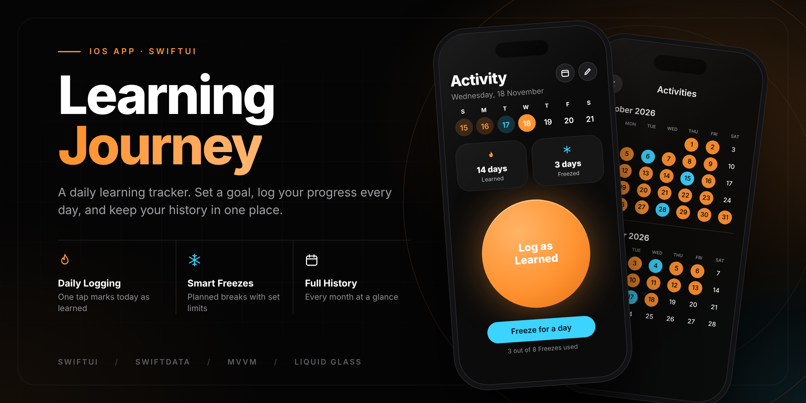
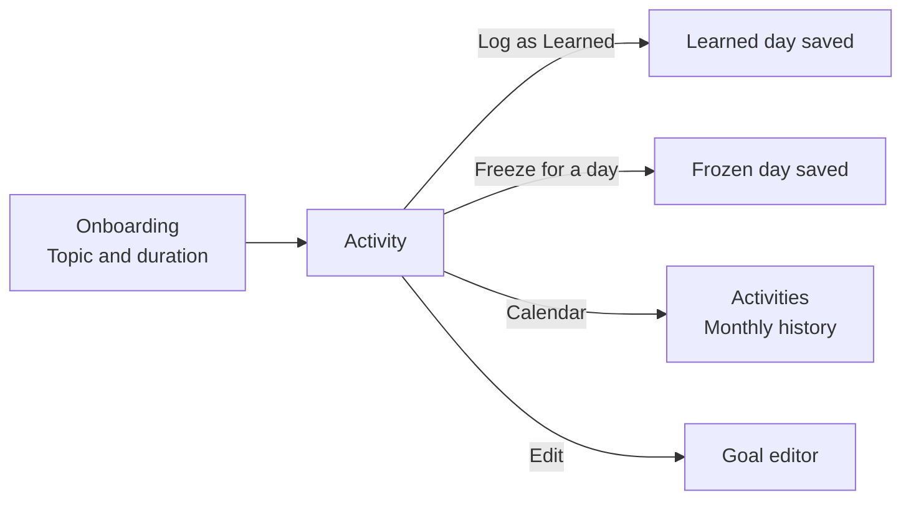
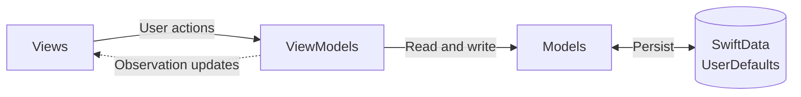

<div align="center">



<br>

# Learning Journey

**A daily learning tracker for iOS, built with SwiftUI.**

<p>
  
  
  
  
  
</p>

[Overview](#overview) · [Features](#features) · [How It Works](#how-it-works) · [Architecture](#architecture) · [Getting Started](#getting-started) · [Roadmap](#roadmap)

</div>

---

## Overview

**Learning Journey** helps you turn learning into a daily habit. You set a learning goal for a week, a month, or a year, then come back each day to log your progress or take a planned break. Your goal and your history are saved on the device, so they are still there when you reopen the app.

---

## Features

The following features are available in the current build.

### Goal setup
- Enter the topic you want to learn and choose a duration: **Week**, **Month**, or **Year**.
- **Start Learning** only continues once both a topic and a duration are selected.

### Daily activity
- **Log as Learned** records today as a learning day. Each day can be logged once, after which the button shows **Logged as Learned**.
- **Freeze for a day** records a planned break, within a limit set by the goal's duration.
- The **Learned** and **Freezed** cards show the total number of days for each.
- A week strip highlights learned days in orange and frozen days in blue.

### Activity history
- The calendar button opens **Activities**, a scrollable monthly history of every learned and frozen day.
- History is view-only, so past days cannot be changed by accident.

### Goal editing
- The edit button opens a goal editor where you can change the topic and the duration.

### Saved progress
- The current goal is saved with `UserDefaults`.
- Learned and frozen days are saved with **SwiftData**.

### Freeze limits

| Goal duration | Length | Freezes allowed |
|:--|:-:|:-:|
| Week | 7 days | 2 |
| Month | 30 days | 8 |
| Year | 365 days | 96 |

The Activity screen shows the freezes used, for example *3 out of 8 Freezes used*, and blocks new freezes once the limit is reached.

---

## How It Works



1. **Onboarding:** choose a topic and a duration, then tap **Start Learning**.
2. **Activity:** log today as learned, or freeze the day.
3. **Activities:** review your learned and frozen days month by month.
4. **Goal editor:** change your topic or duration at any time.

---

## Architecture

The project follows the **MVVM** pattern: Models hold the data, ViewModels hold the logic, and Views display the interface.



| Layer | Components | Responsibility |
|---|---|---|
| Models | `Goal`, `GoalDuration`, `Activity`, `AppPhase` | The goal, its duration, each logged day, and the current app phase |
| ViewModels | `OnboardingVM`, `ActivityVM` | Goal validation, logging, counts, freeze limits, and loading saved days |
| Views | `OnboardingView`, `ActivityView`, `CalendarView`, `ChangeGoalView` | The user interface |

### Project structure

```
learning/
├── MyApp.swift                 App entry point and goal persistence
├── Models/
│   ├── Goal.swift              Goal and GoalDuration
│   ├── Activity.swift          SwiftData model for a learned or frozen day
│   └── AppPhase.swift          Onboarding or main screen
├── ViewModels/
│   ├── OnboardingVM.swift      Topic, duration, and start logic
│   └── ActivityVM.swift        Logging, counts, freeze limits, and loading
└── Views/
    ├── OnboardingView.swift    Goal setup screen
    ├── ContentView.swift       Main container
    ├── ActivityView.swift      Daily activity screen
    ├── CalendarView.swift      Monthly activity history
    └── ChangeGoalView.swift    Goal editor
```

---

## Built With

| Technology | Purpose |
|---|---|
| SwiftUI | User interface |
| SwiftData | Saving learned and frozen days |
| UserDefaults and Codable | Saving the current goal |
| Observation | Keeping views in sync with ViewModels |
| Liquid Glass | Glass-style buttons and cards |

---

## Getting Started

### Requirements
- A Mac with the latest version of Xcode
- An iPhone or simulator running iOS 27.2 or later

### Installation
1. Clone the repository:
   ```bash
   git clone https://github.com/Reef-ghost/Learning.git
   ```
2. Open `learning.xcodeproj` in Xcode.
3. Select an iPhone simulator and press **Run** (`⌘R`).

---

## Roadmap

The following features are planned and **not yet available**:

- [ ] An **Update goal** confirmation before saving a goal change
- [ ] A learning streak that resets after a missed day
- [ ] A goal result screen with an option to set a new goal

---

<div align="center">

**Reef Asiri** · [@Reef-ghost](https://github.com/Reef-ghost)

Developed at the Apple Developer Academy

</div>
